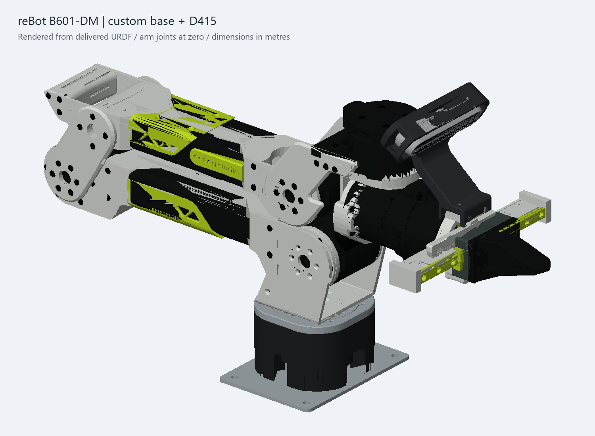

# reBot B601-DM with D415

URDF description of the Seeed reBot B601-DM with a custom mounting base, wrist camera bracket, and RealSense D415 camera geometry. Includes a local viewer with sliders for all six arm joints and the coupled gripper.



[日本語の仕様・注意事項](README_ja.md)

## Interactive viewer

Python 3.9+ and a browser with WebGL are sufficient. No pip or npm installation is needed; dependencies are bundled locally.

```sh
python3 viewer/serve.py --port 8891
```

On Windows, use `py viewer/serve.py --port 8891` if `python3` is unavailable. Open http://127.0.0.1:8891/ in your browser. The server listens only on localhost.

J1–J6 move the arm joints within their original limits. The gripper slider moves both fingers through the original mimic relation. The camera and mount follow the wrist. Drag to orbit, right-drag to pan, and scroll to zoom. The initial-pose button restores zero joint values. The viewer does not perform collision detection.

## URDF files

- `urdf/ReBot_B601_DM_D415.urdf`: relative mesh paths; retain the folder structure.
- `urdf/ReBot_B601_DM_D415.ros.urdf`: ROS 2 package paths.
- `source/ReBot_Arm_DM.original.urdf`: upstream reference, unmodified.

ROS 2 package name: `rebot_b601_description`. Place the repository in your workspace's `src`, run `colcon build --packages-select rebot_b601_description`, and source the workspace before loading the ROS URDF. All distances and STL coordinates are metres; angles are radians. Do not apply another mesh scale.

## Changes

The custom base includes the visible CAD base and a 100 x 140 x 3 mm mounting plate. Hidden original base components and long mounting screws are omitted. The current D435_Gemini2_Mount v3 bracket and D415_Solid v1 camera bodies attach rigidly to the wrist/end link. The bracket's original name does not change the installed camera type: this version uses D415 geometry.

Original arm/gripper joints, limits, axes, origins and mimic are preserved. Non-base inertial and collision definitions are preserved. Extra visuals are placed in identity fixed child links to work around ROS 2 Jazzy RViz multi-material rendering without changing mesh poses or kinematics.

`base_link` retains the upstream frame. `mounting_plate_frame` is the custom plate's lower face center. `camera_link` uses X forward, Y left, Z up; `camera_optical_frame` uses X right, Y down, Z forward.

## Verification and limitations

```sh
python3 tools/validate_package.py
```

`validation.json` contains the CAD transform, mesh reconstruction error and camera attachment verification over 30 sampled arm configurations. `SHA256SUMS.json` records public package content hashes.

Modified base, camera and mount inertials are omitted because actual assembly mass and inertia are unmeasured. The optical frame is nominal geometry alignment, not calibrated depth/RGB sensor extrinsics. Dynamics, gravity compensation, and collision-free travel across the full joint range have not been validated. Detailed custom collision meshes may need simplification for a particular planning or physics engine.

## Sources and licenses

Original robot description and meshes: [Seeed-Projects/reBot-DevArm](https://github.com/Seeed-Projects/reBot-DevArm), commit `b98bee1d6c55d041e08e0f2035d888ad19fff1ee`, `Rebot_Arm_description/DM`. Provenance: `source/provenance.json`. Hardware description license: CERN-OHL-W-2.0; see `LICENSE` and `LICENSE.upstream`.

Custom assembly geometry was exported from the modified Fusion CAD on 2026-11-10. The D415 body was imported from vendor CAD. Third-party CAD copyright and license terms remain with their respective owners. This is a community variant, not an official Seeed or RealSense release.

Bundled Three.js r180 is MIT-licensed; urdf-loader 0.12.6 is Apache-2.0-licensed. Their license texts are retained under `viewer/vendor/`.
